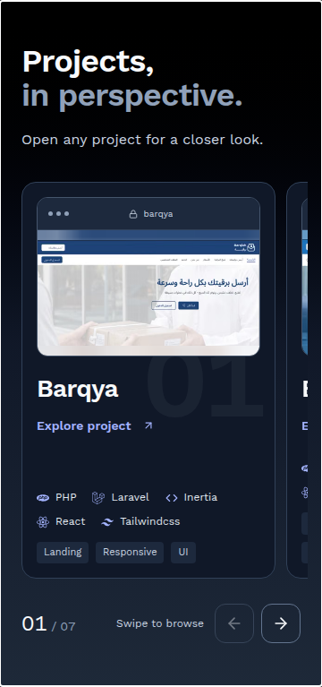

# Compact mobile project shelf

Below 768px, the seven full-height project cards previously required more than 4,400px of vertical scrolling. The same ordered list now becomes a native horizontal snap shelf: a screenshot-led card, a glimpse of the next card, an announced position counter, and 44px previous/next controls. Summaries remain in the existing case-study dialog; all project titles, screenshots, technologies and tags stay on the cards. No CMS content or dependencies changed.

## Measured section height

| Viewport width | Before | After | Reduction |
|---|---:|---:|---:|
|360px|4,401px|766px|82.6%|
|390px|4,454px|783px|82.4%|
|768px|6,267px|6,267px|Unchanged desktop stack|
|1440px|6,314px|6,314px|Unchanged desktop stack|

Additional final widths 320/640/767px measured 770/810/815px. See [baseline](before.json) and [regression results](results.json).

## Behavior and accessibility

- Vertical swipes across a card continue scrolling the page. Horizontal swipes browse projects with native momentum/snapping. There is no mobile pinning, autoplay, scrub or parallax.
- Previous/next buttons are alternatives to swiping. Arrow keys, Home/End and Tab navigate cards; Enter/Space opens a case study. Back/ESC closes and restores the original card focus and horizontal position.
- Reduced motion uses instant button-driven scrolling. Existing desktop GSAP behavior remains scoped and cleans up when crossing the breakpoint.
- Review/polish corrected an overlap between the floating page shortcuts and shelf controls. The floating shortcuts now step aside while Projects is active on mobile; the header Hire me link remains available.
- Mobile loading-placeholder height now matches the compact shelf. A slow section import no longer reserves a 4,700px empty column.
- Existing theme/font tokens, image alt text, automatic direction for CMS text and responsive/lazy images are retained. Screenshots are never mirrored.

## Verification

`npm run build`, `npx tsc -b --pretty false`, `npm run lint`, and `git diff --check` passed. Playwright covered 320,360,390,640,767,768 and 1440px with zero page overflow and zero axe WCAG A/AA violations in Projects. All seven projects remained reachable, controls measured 44×44px, and no console warnings/page exceptions were observed.

Chromium synthesized touch verified both horizontal and vertical gestures across the card surface, including that a drag does not accidentally open a case study. Pointer clicks, keyboard controls, Back/ESC/focus restoration, reduced motion and mobile/desktop trigger cleanup also passed. An early automated scroll assertion was caused by Playwright's locator click scrolling the control into view; direct pointer clicks confirmed the shelf itself leaves vertical page position unchanged.

Physical iOS Safari was not available. Browser-emulated gestures are not represented as hardware testing. Lighthouse was not rerun for this targeted below-fold change; the prior global audit remains a historical measurement.

Reproduce using the existing external audit-tool setup in `scripts/audit/README.md`, then run `node scripts/audit/mobile-project-shelf.mjs`. Results and screenshots go to `/tmp/portfolio-mobile-shelf`.
